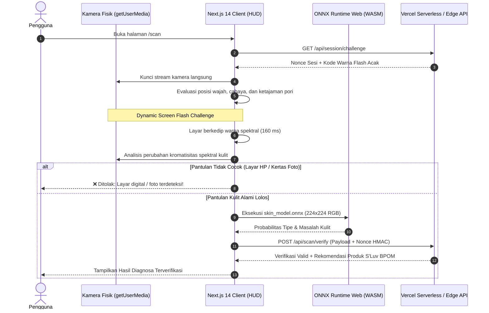

# Smart Skin Scanner & Rekomendasi Skincare (Next.js 14 + ONNX Web)

Aplikasi web analisis kondisi kulit wajah dan pendukung keputusan rekomendasi produk kosmetik katalog **Toko Annisa Beauty Shop** berbasis **Deep Learning (MobileNetV3 Multitask ONNX)** yang dilengkapi dengan sistem validasi **Kamera Langsung & Anti-Manipulasi (*Presentation Attack Detection & Cryptographic Anti-Tampering*)** serta mesin rekomendasi berbasis aturan (*Rule-Based Matching*).

Didesain khusus untuk berjalan dengan performa tinggi dan biaya komputasi server **nol rupiah (Zero Server-Compute Cost)** di platform **Vercel**.

---

## 🌟 Fitur Utama & Proteksi Kamera Langsung

### 1. Dynamic Screen Flash Challenge (Anti-Foto & Anti-Layar Replay)
- **Pengukuran Respon Spektral**: Saat wajah pengguna terdeteksi stabil di bingkai oval, layar memancarkan kilatan spektrum warna acak (*Cyan, Magenta, atau Amber*) selama 160 milidetik.
- **Kromatisitas Difus Kulit Asli**: Sistem mengukur pergeseran kromatisitas ($\Delta \text{RGB}$) pada lapisan epidermis kulit. Kulit manusia asli menyerap dan memantulkan spektrum cahaya dinamis secara difus, sedangkan foto cetak kertas dan layar gadget lain (yang memiliki emisi *backlight* sendiri) gagal memantulkan warna ini secara sinkron.
- **Deteksi Moiré & Tekstur**: Analisis varians Laplacian ($\text{Var}(\nabla^2 I)$) untuk memvalidasi tekstur pori-pori mikro dan menolak interferensi kisi piksel (*Moiré pattern*) dari layar monitor/laptop.

### 2. Hardware Camera Lock (Zero-Upload Policy)
- Pemindaian diwajibkan melalui sensor kamera fisik langsung (`facingMode: "user"`).
- Tidak menyediakan tombol unggah berkas dari galeri untuk mencegah manipulasi foto hasil filter kecantikan (*beauty cam*), editan Photoshop, atau video loop dari *virtual camera* (OBS/ManyCam).

### 3. Integritas Kriptografis (Vercel Edge & Serverless Nonce)
- **One-Time Challenge Nonce**: Sebelum pemindaian, browser meminta token tantangan berumur pendek (TTL 45 detik) dari `/api/session/challenge`.
- **Anti-DevTools Tampering**: Hasil inferensi ditandatangani menggunakan tanda tangan kriptografis HMAC-SHA256 sebelum diverifikasi di `/api/scan/verify`. Pengguna tidak dapat memanipulasi skor probabilitas di konsol peramban JavaScript.

### 4. Inferensi Super Cepat di Browser (WASM SIMD)
- Menggunakan model `skin_model.onnx` berukuran hanya **4.68 MB**.
- Berjalan via **ONNX Runtime Web** memanfaatkan akselerasi WebAssembly SIMD. Inferensi selesai dalam 30–60 ms di sisi peramban klien tanpa membebani kuota server Vercel.
- **100% Client-Side Privacy**: Citra wajah diproses secara lokal di RAM perangkat dan tidak pernah diunggah ke server cloud (*Zero-Biometric Upload*).

### 5. Mesin Rekomendasi Skincare Katalog Toko Annisa Beauty Shop
- **Rule-Based Matching**: Menghubungkan tipe kulit (*Normal, Berminyak, Kering, Kombinasi*) dan masalah kulit (*Jerawat, Flek Hitam, Kemerahan, Pori-pori, Garis Halus*) dengan katalog produk Toko Annisa Beauty Shop resmi terdaftar BPOM RI beserta alasan kecocokan bahan aktif (*Active Ingredients*).

---

## 📐 Arsitektur Sistem



---

## 📁 Struktur Direktori Proyek

```
demo/
├── app/
│   ├── api/
│   │   ├── session/
│   │   │   └── challenge/
│   │   │       └── route.ts         # Vercel API: Generator Nonce & Flash Challenge
│   │   └── scan/
│   │       └── verify/
│   │           └── route.ts         # Vercel Serverless: Validasi Tamper & Rekomendasi
│   ├── scan/
│   │   └── page.tsx                 # Halaman Scan Interaktif (Radar HUD & Flash Screen)
│   ├── layout.tsx                   # Layout global (Font, Header/Footer, ort.min.js)
│   ├── globals.css                  # Tailwind styles, glassmorphism, animasi neon
│   └── page.tsx                     # Landing Page & Lembar Persetujuan (Informed Consent)
├── lib/
│   ├── onnx.ts                      # Pipeline inferensi onnxruntime-web & normalisasi NCHW
│   ├── flash-liveness.ts            # Algoritma evaluasi kromatisitas spektral & Laplacian
│   └── recommendations.ts           # Mesin pencocokan produk skincare berbasis aturan
├── public/
│   ├── models/
│   │   ├── skin_model.onnx          # Model kuantisasi MobileNetV3 (4.68 MB)
│   │   └── labels.json              # Konfigurasi kelas & threshold deteksi
│   └── products.json                # Basis data 32 kosmetik resmi BPOM RI
├── next.config.mjs                  # Konfigurasi header COOP/COEP & caching ONNX
├── tailwind.config.ts               # Desain tema Annisa Beauty Shop
├── vercel.json                      # Konfigurasi caching CDN edge Vercel
└── package.json                     # Dependensi Next.js 14, React 18, Tailwind
```

---

## 🚀 Panduan Menjalankan Lokal & Deploy ke Vercel

### 1. Menjalankan di Lokal (Development)

Pastikan telah menginstal [Node.js](https://nodejs.org/) (versi 18 ke atas).

```bash
# 1. Clone repositori
git clone https://github.com/oziajayakan/demo.git
cd demo

# 2. Instal dependensi
npm install

# 3. Jalankan server lokal Next.js
npm run dev
```

Buka peramban di: **`http://localhost:3000`**

### 2. Deploy ke Vercel (Produksi)

Aplikasi ini 100% kompatibel dan siap dideploy langsung ke **Vercel**:
1. Masuk ke dashboard [Vercel](https://vercel.com).
2. Pilih **"Add New Project"** lalu impor repositori `https://github.com/oziajayakan/demo`.
3. Vercel akan otomatis mendeteksi framework **Next.js**.
4. Klik **"Deploy"**. Proyek akan aktif dalam waktu kurang dari 1 menit!
